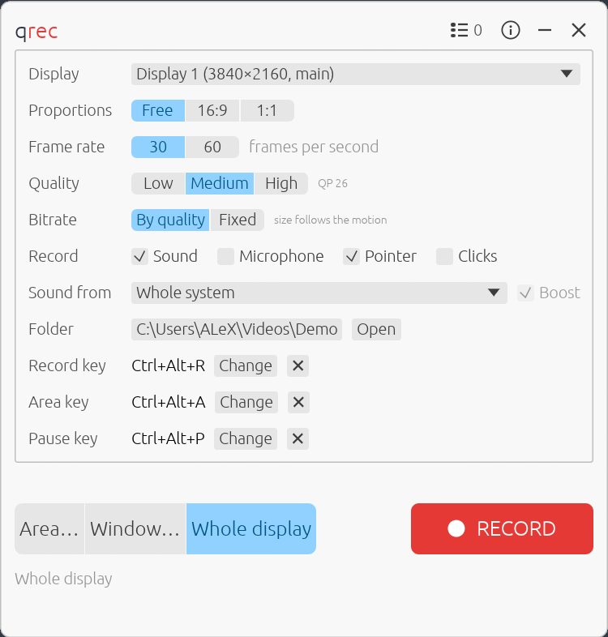

<p align="center">
  
</p>

<p align="center">A simple screen area recorder for Windows</p>

<p align="center">
  <a href="https://github.com/Fan4Metal/qrec/releases/latest"></a>
  
  <a href="LICENSE"></a>
</p>

<p align="center"><b>English</b> | <a href="README.ru.md">Русский</a></p>

qrec records a rectangle of the screen, or a whole display, to an MP4 file: H.264 video encoded by the graphics card, the sound the computer plays as AAC, and the pointer. The window holds the few settings there are, a global hotkey starts and stops the recording from anywhere, and another one opens the area selection.

<p align="center">
  
</p>

*The window of version 0.2.0.*

## Features

- **An area, a window or a display**: the area is drawn with the mouse over a dimmed screen, freely or in the proportions 16:9 or 1:1, or a window is clicked and followed as it moves; a red frame marks it while it is recorded.
- **Hardware encoding**: H.264 by the NVIDIA, Intel or AMD encoder of the graphics card through Media Foundation, with Microsoft's software encoder as the fallback; frames go from the screen to the encoder without leaving the graphics card.
- **The sound of the computer without "Stereo Mix"**: whatever is played is captured through WASAPI loopback and written as AAC; no virtual cable or driver is needed.
- **The microphone**, mixed with the sound of the computer or alone.
- **The sound of one program**: instead of the whole system, the sound of a single program can be recorded, and with **Boost** at full volume, whatever its volume in the Volume Mixer.
- **The pointer** is drawn into the recording, including the inverted I-beam, and its clicks can be shown as coloured rings.
- **Trimming without re-encoding**: the start and the end of a recording are cut off in a window with the frame under the cursor and a timeline; the chosen stretch is copied into a new file as it is, in a moment and without loss of quality, or written as an animated GIF.
- **Few settings**: 30 or 60 frames per second, a quality of three steps, a bitrate that follows what is on the screen or one fixed beforehand, and whether sound and the pointer are recorded.
- **Hotkeys**: `Ctrl+Alt+R` starts and stops the recording, `Ctrl+Alt+A` opens the area selection, `Ctrl+Alt+P` pauses and resumes the recording; each is changed in the window by pressing another combination, or removed.
- **An icon in the notification area**: red while a recording runs, with the time recorded in its tooltip; its menu starts and stops the recording, opens one of the latest recordings, and can leave the program in the notification area alone, without a taskbar button, make the window's cross hide it there, or put the window away when a recording starts.
- **Nothing of qrec in the recording**: its own windows are kept out of the capture.
- **Russian and English**: the interface follows the language of Windows, or the one chosen in the About window.
- **One file**: no FFmpeg, no runtime, no network access unless the [update check](#update-check-and-privacy) is enabled; the executable is about 7 MB.

## Installation

The installer and the portable archive are published on the [Releases](https://github.com/Fan4Metal/qrec/releases) page.

The installer, `qrec_<version>_Setup.exe`, needs no administrator rights: the program is placed in `%LOCALAPPDATA%\Programs\qrec`. The installed program keeps its settings in `%APPDATA%\qrec`; when the program is uninstalled, a question decides whether they are deleted too. A running copy is closed by the installer and the uninstaller as its cross would close it: a recording in progress is completed first.

The portable archive, `qrec_<version>_portable.zip`, contains the program in a `qrec` folder and runs without installation. It also contains an empty `app.ron` file: while it lies beside `qrec.exe`, the settings are kept in that folder, so the program can be carried on a removable drive (the folder must be writable); without it they are kept in `%APPDATA%\qrec`, as for the installed program.

Requirements: Windows 10 version 2004 or later, 64-bit; the installer does not run on earlier versions. On earlier builds of Windows 10 the portable version runs, but the sound is captured from the default output device instead of through the process loopback (see [Sound](#sound)), the sound of one program cannot be recorded, and the windows of qrec may appear in the recording.

## Usage

| Setting | Meaning |
|---|---|
| Display | The monitor to record, when there are several. The area belongs to one monitor. |
| Proportions | **Free**, **16:9** or **1:1**: the shape of the area drawn with the mouse. A 16:9 area changes in steps of 2 pixels, its height rounded to the even number H.264 needs, so it is within a pixel of 16:9 and exact where the ratio allows it (1280×720, 1920×1080); a 1:1 area is a square. The corner where the drag starts stays in place, and the area stops at the edge of the monitor. An area already chosen takes the new proportions around its centre. |
| Area | **Area…** hides the window and dims the screen; the area is drawn with the left mouse button, `Esc` or the right button cancels. **Window…** dims the screen the same way and outlines the window under the pointer; a click takes it: its area, cut to its monitor; a recording of it then follows the window as it moves (its size stays as chosen, within the monitor), and the status line names the window. **Whole display** records the monitor entirely. The current choice of the three is highlighted. The area is remembered between runs (the window it followed is not). |
| Frame rate | 30 or 60 frames per second. A still screen costs nothing extra: the last image is repeated. |
| Quality | Low, Medium or High. With the bitrate **By quality**, the quantisation parameter of every frame (30, 26 or 22); with a **Fixed** bitrate, about 0.05, 0.1 or 0.2 bits per pixel and frame. |
| Bitrate | **By quality** (the default): every frame is encoded to the same quality, and the file follows what is on the screen: a still screen takes almost nothing, fast motion as much as it needs. **Fixed**: the encoder is given a bitrate from the area, the frame rate and the quality; 1920×1080 at 30 frames per second comes to about 3, 6 or 12 Mbit/s, and the window shows the most the chosen area takes, in Mbit/s and in megabytes per minute with the sound. The size is then known beforehand, and fast motion loses detail. An encoder that does not accept a constant quality records at the fixed bitrate, which the status line mentions when the recording starts. |
| Record | **Sound**: the sound, from the source below. **Microphone**: the default microphone of Windows, mixed with the sound (either can be recorded alone). **Pointer**: the mouse pointer. **Clicks** (with the pointer): a disc under the pointer while a mouse button is held and a ring that spreads and fades from each press, yellow for the left button and blue for the right one; off by default. |
| Sound from | **Whole system**: everything the computer plays, at the volume it is played. Or one of the programs that have played sound since they started (those of the Volume Mixer; the ones playing now are shown brighter): only its sound. **Boost**, beside the list, records it at full volume whatever its volume in the mixer; without it the program is recorded as it is heard (see [Sound](#sound)). Two programs of one name (two copies of a browser) are told apart by the folder they are in, `Vivaldi (VP)`. The program is remembered by the path of its executable and must be running when a recording starts; when it runs more than once, the copy that plays at that moment is recorded. |
| Folder | Where the files go; `Videos` by default. **Open** shows the folder in Explorer. |
| Record key | Starts and stops the recording from any window; `Ctrl+Alt+R` by default. A click on **Change**, then a key with `Ctrl`, `Alt` or `Win`, or a function key, sets another one; `Esc` or **Cancel** keeps the current one; the cross beside **Change** removes the hotkey. A combination held by another program is reported as not available. |
| Area key | Opens the area selection from any window, as **Area…** does; `Ctrl+Alt+A` by default, changed and removed in the same way. It does nothing while a recording runs. A window minimised or hidden in the notification area stays so after the selection. |
| Pause key | Pauses and resumes the recording from any window, as the pause button does; `Ctrl+Alt+P` by default, changed and removed in the same way. It does nothing while no recording runs. A combination given to one of the three hotkeys is taken from the others. |

**Record** starts the recording; while it runs, the button shows the time recorded and stops the recording when clicked, and a pause button left of it pauses the recording and resumes it (also from the menu of the notification area icon): the time paused is left out of the file, picture and sound alike, and the clock stands still meanwhile. The number of frames skipped, if the computer could not keep up, appears below. A red frame surrounds the area while it is recorded. The file is named by the date and time, `qrec_2026-10-08_16-45-12.mp4`, and after the recording it appears below the buttons as a card: a small picture of it (a click opens it for trimming), its name, a link that shows it in Explorer, its length, size and picture size, and two buttons: scissors to trim it (see [Trimming](#trimming)) and a waste bin that moves it to the Recycle Bin, for a take that is not worth keeping.

The button with a list and a number in the title row, left of the "i", opens a window beside the main one that lists the latest fifty recordings of the folder (the files named `qrec_…`, cuts included; the number is how many there are), newest first: a large picture of each (a frame a second in; a click opens it for trimming), when it was made, its name, length, size and picture size, and the same two buttons. Below the list are how many there are and how much they take, and **Clear…**, which moves all of them to the Recycle Bin at once after a confirmation in the same place (`Esc` cancels it). The window is docked to the main one: it stands beside it (at the right, or at the left when the display has no room there) with the same top and height, moving either moves both, bringing either to the front brings both, and minimising or hiding the main window takes the list away with it until the main window is back. Its outer edge changes its width; it is closed by its cross, `Esc` or the same button in the title row, which stays highlighted while the window is open. The menu of the notification area icon has the five latest under **Latest recordings** (a click on one opens it in the trimming window), with **All recordings…**, which opens the window.

### Trimming

A recording usually holds a little of what came before and after what was wanted, as it is started and stopped by hand. The scissors beside the last recording, or beside one in the list, open a window that cuts the start and the end off without re-encoding: the chosen stretch of the file is copied into a new one beside the source, `qrec_2026-10-08_16-45-12_0.02.000-0.14.500.mp4`, as it is, in a moment and without loss of quality; the source is left as it was (unless **Replace the original** is ticked, see below). The same window opens for an MP4 file dropped onto the qrec window, or given to `qrec.exe` as its argument (Explorer's **Open with**); with **Trim after recording** in the menu of the notification area icon, it opens by itself when a recording ends.

The window shows the frame under the cursor and a timeline with the stretch kept and the key frames marked under it. The cursor is moved by dragging on the timeline or with the arrow keys: by a frame, with `Shift` by a key frame, with `Ctrl` by a second; `Home` and `End` go to the first and the last frame. Under the timeline the buttons that move the cursor are in the middle, around the button with a triangle (`Space`), which plays the recording with its sound from the cursor and pauses it; the time under the cursor is at the left of the same row. A click on the length of the stretch under it (`Shift+Space`) plays the stretch kept, from its start to its end. Moving the cursor stops playback. The buttons **[** (`I`) and **]** (`O`) either side of them place the start and the end of the stretch at the cursor; the marks can also be dragged, and a click on the time beside either moves the cursor there. H.264 is decoded from a key frame, so without re-encoding the stretch can only start on one: the start sticks to the key frame nearest the cursor or the pointer, before or after it. qrec puts a key frame every second, so the start is within half a second of the choice; the end is exact to the frame. The sound is cut to the same stretch. **Save the cut** (`Ctrl+S`) writes the file. **GIF** beside it writes the same stretch as an animated GIF instead, for a chat or an issue tracker: 15 frames per second (fewer when the recording has fewer), scaled down to at most 960 pixels a side, without sound; only what changes from frame to frame is stored, so a recording of a mostly still screen stays small. With **Replace the original** the cut takes the place of the file it was made from instead of going into a new one, and the original goes to the Recycle Bin; a file that is open in another program is not replaced. The choice, and the window's place and size, are remembered.

The window opens MP4 files with H.264 video and AAC sound, as qrec writes them. Files of other programs usually have key frames every few seconds, which limits where a cut can start.

The area is cut to the monitor it was started on, its sides are made even (as H.264 requires), and it is at least 64 pixels on each side. The whole display is recorded when the area is outside the monitor, for instance after the displays were rearranged.

The icon of qrec in the notification area turns red while a recording runs, and its tooltip shows the time recorded. A click on the icon brings the window to the front; its menu (right button) starts or stops the recording, pauses and resumes it, shows the window, opens one of the **Latest recordings** in the trimming window or the folder of the recordings, opens **About**, or closes the program. **Not on the taskbar** in the same menu removes the window's button from the taskbar (and from `Alt+Tab`): the minimise button then hides the window, and the icon brings it back. **Hide when closed** makes the cross in the window's corner hide the window instead of closing the program; `Alt+F4` and the **Exit** item still close it. **Minimise when recording starts** minimises the window as a recording starts, however it was started (hidden instead when the window is not on the taskbar), and brings it back when the recording stops; a window that was already minimised or hidden (a recording started by the hotkey) stays so. **Count down before recording** starts a recording three seconds after **Record** or the hotkey, counting them down in a dark square in the middle of the area (which is not recorded); a second press during the count cancels the recording. **Trim after recording** opens every recording in the trimming window as soon as it ends (see [Trimming](#trimming)). The choices are remembered. Windows 10 places a new icon among the hidden ones, behind the arrow; it can be dragged from there onto the taskbar.

The **i** button in the window's title row (or **About** in the icon's menu) shows the version, the author, the homepage and the licence, where the settings are kept, the interface language (as in Windows, English or Russian; the choice applies at once and is remembered), and the [update check](#update-check-and-privacy).

Closing the window during a recording completes the file first.

One copy of qrec runs at a time. Starting it again brings the running window to the front, even from the notification area, and an MP4 file given to the second start (Explorer's **Open with**) opens in the running copy's trimming window. The command line modes run alongside the window.

## Sound

The sound is captured with the *process loopback* of Windows 10 version 2004 and later: the audio engine delivers everything that is played by other programs, in floating-point stereo at 48 kHz, regardless of the output device and without "Stereo Mix" or a virtual cable. qrec's own sounds, if any, are left out. Programs that play in WASAPI exclusive mode bypass the audio engine and are not captured.

The sound of one program is the process loopback of that program and its child processes (a browser plays from a child process). The audio engine delivers it after the program's volume in the Volume Mixer: at 25 % it is 12 dB quieter, as it is heard. With **Boost**, qrec follows that volume during the recording and divides the sound by it, so the program is recorded as at 100 %, and a change of the volume during the recording does not reach the file. Up to 1 % is undone (a gain of up to 100); a program muted in the mixer is recorded as silence. The device's master volume does not reach the capture when the device applies it in hardware; otherwise the recording follows it. When a program has several sessions at different volumes, the loudest one is taken.

On earlier builds of Windows 10, the default output device is opened for loopback capture instead, which captures what is played through that device.

The microphone is captured from the default recording device of Windows, converted by the audio engine to the same format, and mixed with the sound of the computer by the time of each packet; a stream that delivers nothing for more than a second is taken as silence meanwhile, so neither holds the other up. The recording does not wait for the microphone: opening it can take a few seconds, or as long as an antivirus asks whether qrec may capture sound, and until then the microphone is silent in the file. When it cannot be opened (access to the microphone is turned off in the privacy settings of Windows, say), the recording goes on without it and the window says so.

The audio and the video share one clock, the performance counter of Windows: a packet of sound is placed at the time it was recorded, gaps are filled with silence, and the video frames are stamped at fixed intervals of the same clock, so the two stay in step.

## Limitations

- A display with HDR enabled is recorded in SDR: white is taken at the level of **SDR content brightness** in the Windows display settings, brighter parts are compressed softly towards it, and colours outside sRGB are clipped. The file itself is SDR (BT.709), as from any other display.
- Rotated displays are captured in their native orientation.
- Content that Windows protects from capture (some video players, DRM) appears black, as in any screen capture.
- One area on one monitor; no webcam. The microphone is the default one of Windows, at the level set there.

## Command line

```
qrec.exe --record SECONDS [--region X,Y,W,H] [--monitor N] [--fps N] [--quality low|medium|high] [--no-audio | --audio-app NAME.exe [--no-boost]] [--microphone] [--no-cursor | --clicks] [--window HWND] [--countdown N] [--pause FROM-TO] [--out FILE]
qrec.exe --cut FILE --from SECONDS --to SECONDS [--out FILE]
qrec.exe --gif FILE --from SECONDS --to SECONDS [--out FILE]
qrec.exe --info FILE
qrec.exe FILE.mp4
```

`--record` records without the window for the given number of seconds, from a console: `--region` is on the virtual screen (physical pixels), `--monitor` counts from 1 with the primary display first, `--audio-app` records the sound of one program, named by its executable (`firefox.exe`) or its full path, boosted unless `--no-boost` is given, `--microphone` mixes in the default microphone, `--window` records the window with that handle and follows it, `--countdown 3` counts three seconds down over the area first, `--pause 2-5` pauses the recording from the second to the fifth second of the run, and the defaults are the whole primary display, 30 frames per second, medium quality, with sound and the pointer, into `qrec_<date>_<time>.mp4` in the current folder.

`--cut` copies the stretch between the two times into a new file without re-encoding, from the key frame at or before `--from` up to the frame before `--to`, into `<name>.cut.mp4` beside the source unless `--out` names the file. `--gif` writes the stretch as an animated GIF, as the trimming window does, into `<name>.gif` unless `--out` names the file. `--info` prints the size, the frame rate and the length of a file and the times of its key frames. A file given on its own opens the window with the trimming window on that file.

## Update check and privacy

The update check is optional and off by default. With **Check for updates at start-up (once a day)** enabled in the About window, the program asks the GitHub Releases API (`api.github.com`) for the latest release at most once a day; **Check now** in the same window asks at once. The request carries nothing but the program version in its `User-Agent` header, and nothing is downloaded or installed: when a newer release exists, a button with its version appears in the window's title row, left of the recordings button, and an item in the menu of the notification area icon; either opens the release page in the browser. Otherwise the program does not access the network.

## Building

Requirements: Windows 10 or later, stable Rust with the MSVC toolchain and Visual Studio 2022 Build Tools.

```
cargo build --release    # target\release\qrec.exe
cargo test
```

The window is drawn by egui/eframe through OpenGL (glow). Screen capture, colour conversion, encoding, muxing and audio capture use Windows itself: Desktop Duplication, the Direct3D 11 video processor, Media Foundation and WASAPI, through the `windows` crate. The executable links the C runtime in (`.cargo/config.toml`, `crt-static`), so qrec needs nothing beyond Windows. Setting the environment variable `QREC_TRACE=1` writes what the recording does to stderr (a debug build has a console; a release build shows it when started from one).

## Installer and release

The release script builds the executable, the installer and the portable archive (Inno Setup 6 is required):

```
python tools/make_release.py              # tests, release build, installer, archive
python tools/make_release.py --no-tests   # the same without cargo test
python tools/make_release.py --install    # then a silent installation over the installed copy
```

The files are written to `dist`; the version is taken from `Cargo.toml`. The script first closes a `qrec.exe` running from `target\release`. The installer script is `tools/setup.iss`; the installer icon is written by `qrec.exe --export-icon <file.ico>`.

Releases on GitHub are built by the **Release** workflow (`.github/workflows/release.yml`). After the version in `Cargo.toml` is updated and committed, pushing a matching tag publishes a release with the installer and the portable archive:

```
git tag v0.1.0
git push origin v0.1.0
```

Running the workflow manually (Actions → Release → Run workflow) only builds the files and attaches them to the run, without a release.

## Built with

qrec is built on the following open-source projects:

- [egui / eframe](https://github.com/emilk/egui): the user interface and the window;
- [windows-rs](https://github.com/microsoft/windows-rs): the Windows APIs from Rust;
- [Inno Setup](https://jrsoftware.org/isinfo.php): the installer.

## License

qrec is distributed under the [MIT license](LICENSE).
